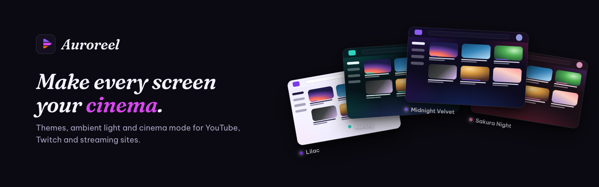

<p align="center">
  
</p>

# Reelskin

**Themes for YouTube, Twitch and streaming sites — plus ambient light, cinema mode and player tools.**
A Chrome extension (Manifest V3). Vietnamese and English.

> 🇻🇳 **Tiếng Việt:** Reelskin làm đẹp YouTube, Twitch và các trang xem phim (Netflix, Prime Video, Disney+,
> Vimeo, FPT Play, VieON…): 24 chủ đề có sẵn, tự tạo chủ đề (kể cả từ một bức ảnh), ánh sáng nền quanh video,
> chế độ rạp, chỉnh tốc độ, bộ lọc màu hình, chụp khung hình, hình trong hình, ẩn Shorts/bình luận/đề xuất, tự
> đổi chủ đề sáng/tối theo giờ, đồng bộ qua Chrome. Không tài khoản, không theo dõi — mọi thứ nằm trên máy bạn.

## Features

|                      |                                                                                                                                                                                                            |
| -------------------- | ---------------------------------------------------------------------------------------------------------------------------------------------------------------------------------------------------------- |
| **24 themes**        | Dark and light, each with a backdrop (aurora glows, gradients or your own picture), glassy top bar and menus, rounded corners and an optional font (Be Vietnam Pro, Lexend, Nunito — all with Vietnamese). |
| **Theme maker**      | Six colours with a live preview and a contrast check; start from one colour, from a picture (its palette is extracted and it becomes the backdrop) or "Surprise me". Export/import theme files.            |
| **Deep recolouring** | A recolouring engine reads the site's own colour tokens and maps them onto the theme, so even parts nobody wrote rules for follow along.                                                                   |
| **Ambient light**    | The video's colours glow around it (accent-coloured glow for protected video).                                                                                                                             |
| **Cinema mode**      | Dims everything but the player; click outside or Esc to leave; optional auto-on.                                                                                                                           |
| **Player toolbar**   | Floating on every video: speed −/+, picture filters (8 presets + sliders), ambient, cinema, loop, frame capture, picture in picture.                                                                       |
| **Shortcuts**        | `S`/`D`/`R` speed, `Z`/`X` ±10 s, `Alt+C` cinema, `Alt+A` ambient, `Alt+S` capture, `Alt+P` PiP, `Alt+L` loop, `Alt+T` pause the theme in a tab — all remappable.                                          |
| **Focus (YouTube)**  | Hide Shorts, the home feed, related videos, comments, end cards, chips, merch, "Explore"; videos per row; blurred or B&W thumbnails; fade watched videos.                                                  |
| **Auto switch**      | Light by day, dark at night — by time or with the system.                                                                                                                                                  |
| **Per site**         | Turn sites on/off, give a site its own theme, player tools on every other site (optional permission).                                                                                                      |
| **Backup**           | Settings and themes (pictures included) in one JSON file.                                                                                                                                                  |

Supported sites: **full** (every colour, backdrop, layout options) — YouTube, Twitch; **recolour** (every colour, in
the site's dark style) — Netflix, Prime Video, Disney+, YouTube Music, FPT Play, VieON; **basic** (accent, background,
font) — Vimeo; **player tools** — any other site once allowed. All of them get every player tool.

## Privacy

No account, no analytics, no server. Settings, themes and pictures live in `chrome.storage.local` on this computer.
Host access is limited to the supported sites (plus VieON's stylesheet CDN); "every other site" is an optional
permission. Chrome Sync is opt-in. See
[docs/PRIVACY.md](docs/PRIVACY.md).

## Development

```bash
npm install
npm run build          # typecheck + production build → dist/ (load unpacked in chrome://extensions)
npm run dev            # rebuild on change
npm test               # unit tests (Vitest)
npx playwright install chromium   # once
npm run test:e2e       # end-to-end + accessibility on Chrome for Testing (local test pages)
npm run test:live      # checks against the real YouTube/Twitch (network, by hand)
npm run lint && npm run format:check
npm run package        # → release/reelskin-<version>.zip for the Chrome Web Store
npm run brand          # brand kit (logo, promo tiles) → brand/
npm run screenshots    # store screenshots (EN/VI) → brand/store/screenshots/
```

Dev tools: `node scripts/probe-site.mjs <url>` lists a site's CSS custom properties (when a site redesigns),
`node scripts/live-shot.mjs <url> out.png --theme=aurora` screenshots a real page with the extension.

How it works: [docs/ARCHITECTURE.md](docs/ARCHITECTURE.md). Store listing copy: [docs/STORE_LISTING.md](docs/STORE_LISTING.md).

Contributing: [CONTRIBUTING.md](CONTRIBUTING.md) · Security: [SECURITY.md](SECURITY.md) · Publishing:
[docs/PUBLISHING.md](docs/PUBLISHING.md) · License: [MIT](LICENSE).

Reelskin is an independent project, not affiliated with YouTube, Google, Twitch, Netflix, Amazon, Disney, Vimeo,
FPT Play or VieON.
